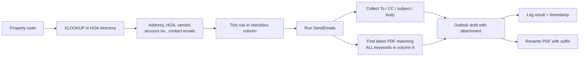

# ✉️ HOA Ledger Request Automation

A macro-enabled Excel tool that drafts **bulk ledger-request emails** to HOA management companies, auto-attaches the correct PDF, and renames the file so it is never sent twice.

## The problem
Requesting HOA ledgers for hundreds of properties meant repeating the same steps by hand: find the property → look up the HOA, vendor and contacts → write the email → search a folder for the right invoice PDF → attach it → rename the file to show it was sent. It was slow and easy to get wrong.

## The solution
Tick the accounts to email and run one macro. For every ticked row it builds the email, finds the latest matching PDF, opens an Outlook draft and records what happened.

## Features
- **Lookup-driven rows** — `XLOOKUP` / `COUNTIF` pull property address, HOA name(s), vendor and account number from a directory sheet
- **Formula-built email text** — a standard request message generated per row
- **Smart attachment matching** — keywords in column A (separated by `;`, `,` or line breaks, de-duplicated, case-insensitive) must *all* appear in the PDF name; the **most recently modified** match wins
- **Optional subfolder search** via a constant
- **Draft or send** — opens each message with `.Display` for review; switch to `.Send` for fully automatic mode
- **Audit trail** — column U logs *Attached / No matching PDFs / No keywords / Skipped: no To*; column T stores a timestamp
- **Safe rename** — appends a suffix before the extension, strips illegal filename characters, avoids double-suffixing and handles name collisions with `(1)`, `(2)` …

## Code
[`src/SendLedgerRequests.bas`](src/SendLedgerRequests.bas)

| Procedure | Role |
|---|---|
| `SendEmails` | Main routine: loops over ticked rows and creates Outlook drafts |
| `FindSingleLatestPdfWithAllKeywords` | Returns the newest PDF that matches every keyword |
| `ProcessFolderForAllKws` | Recursive folder scan |
| `ContainsAllKeywords` | Case-insensitive AND match |
| `SplitKeywords` | Normalises and de-duplicates the keyword list |
| `RenameFileAppendSuffix` / `AppendSuffixBeforeExtension` | Collision-safe rename |
| `IsChecked`, `UBoundSafe` | Input helpers |

## Sheet layout expected by the macro
| Column | Content |
|---|---|
| A | Property code / search keywords (cell **A1** holds the base PDF folder) |
| K, L | "To" email addresses |
| M | "CC" email address |
| N | Email body |
| O | Email subject |
| P | Checkbox / TRUE-FALSE selector |
| T | Timestamp (written by macro) |
| U | Result log (written by macro) |

## Setup
1. Create the sheet with the layout above and save as `.xlsm`.
2. In Excel press `Alt + F11` → **File → Import File…** → choose `SendLedgerRequests.bas`.
3. Put the PDF folder path in cell **A1**.
4. Open desktop **Outlook**, tick the rows to process and run `SendEmails`.

**Requirements:** Windows, desktop Excel with macros enabled, desktop Outlook.

## Privacy note
The working version of this workbook holds a client's property, account and vendor data, so it is intentionally **not** published. Only the code and design are shared here.

## Skills demonstrated
VBA · Outlook object model · FileSystemObject · recursion · input validation · audit logging · AP / HOA workflow design

---
Built by **Harshit** · [Profile](https://github.com/YOUR-USERNAME)
